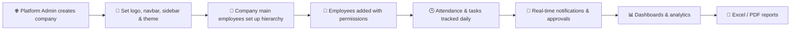

<div align="center">

# 🏢 TeamFlow HRMS

### 👥 One platform for people, attendance, tasks and insights.

An enterprise-grade **Human Resource Management** and **Task Management** system with multi-company support, fully customizable branding, hierarchical control, real-time notifications and advanced reporting.


</div>

---

## 📖 About

**TeamFlow HRMS** helps organizations manage their entire workforce from one place. A platform admin can onboard multiple companies, and each company gets its own branding, its own main employees, teams and permissions. Attendance, tasks, approvals and reports all follow the organization's hierarchy.

---

## ✨ Key Features

### 🏢 Multi-Company Management

- Manage multiple companies from a single platform
- Separate data and settings for every company
- Multiple main employees (company admins) per company
- Company-level configuration and policies

### 🎨 Company Branding & UI Customization

When a company is created, its entire interface can be designed to match its brand:

- 🖼️ **Logo**: upload the company logo and control its size, position and alignment
- 🧭 **Navbar**: custom background color, height, text color and logo placement
- 📚 **Sidebar**: custom background, width, menu colors, active and hover styles, icon style, collapsed or expanded default
- 📄 **Content area**: custom background, card styles, border radius, spacing and fonts
- 🌈 **Theme colors**: primary, secondary and accent colors applied across the whole app
- 🌗 **Light and dark mode** options
- 👁️ **Live preview** while editing the design
- 💾 **Per-company themes**: every company sees only its own design
- 🔄 **Reset to default** at any time

### 🔐 Roles, Permissions & Access Control

- Role-based access control (RBAC) with granular permissions
- Composite permissions that combine multiple roles and scopes
- Global-level and company-level controls
- Per-employee permission overrides
- Hierarchy-based data visibility (managers see their teams)
- Secure JWT authentication

### 🕒 Advanced Attendance

- Check-in and check-out tracking
- Shift management and working-hour rules
- Late, early-exit, overtime and absence tracking
- Leave requests with hierarchical approval
- Holiday calendars and attendance regularization
- Monthly attendance summaries per employee, team and company

### ✅ Task Management

- Create, assign and track tasks across teams
- Priorities, deadlines, labels and status workflows
- Kanban board and list views
- Subtasks, comments and file attachments
- Task delegation along the hierarchy
- Progress tracking and productivity insights

### 🏗️ Hierarchy System

- Multi-level reporting structure
- Departments, designations and teams
- Visual organization chart
- Approval flows that follow the hierarchy

### 🔔 Real-Time Notifications

- Instant push notifications for tasks, leaves, approvals and announcements
- Live dashboard updates without page refresh
- In-app notification center with read/unread status
- Configurable notification preferences

### 📊 Dashboards

- Dedicated dashboards for platform admins, company admins, managers and employees
- Live attendance, task and workforce statistics
- Interactive charts and trend analysis
- Quick actions and pending approvals

### 📑 Advanced Reporting

- Attendance, leave, task, performance and workforce reports
- Detailed filters by company, department, team, employee and date range
- **Export to Excel and PDF**
- Summary and detailed report views
- Scheduled and downloadable reports

---

## 👥 User Levels

| Level                        | Capabilities                                                                         |
| ---------------------------- | ------------------------------------------------------------------------------------ |
| 🌐 **Platform Admin**        | Manage companies, company branding, global settings, roles and platform-wide reports |
| 🏢 **Company Main Employee** | Manage company users, hierarchy, policies, theme and company reports                 |
| 👔 **Manager / Team Lead**   | Manage team attendance, approve requests, assign and track tasks                     |
| 🧑‍💼 **Employee**              | Mark attendance, apply for leave, manage assigned tasks                              |

---

## 🔄 How It Works



---

## 🛠️ Tech Stack

| Layer             | Technology                  |
| ----------------- | --------------------------- |
| 🎨 Frontend       | Angular + TypeScript        |
| ⚙️ Backend        | ASP.NET Core Web API (.NET) |
| 🗄️ Database       | PostgreSQL                  |
| ⚡ Real-time      | SignalR (WebSockets)        |
| 🔐 Authentication | JWT                         |
| 📑 Reporting      | Excel and PDF export        |

---

## 🚀 Getting Started

### ✅ Prerequisites

- Node.js 18+ and Angular CLI
- .NET SDK 8+
- PostgreSQL 14+

### 1️⃣ Clone the repository

```bash
git clone https://github.com/akadta/TEAMFLOW-HRMS.git
cd TEAMFLOW-HRMS
```

### 2️⃣ Create the database

```sql
CREATE DATABASE teamflow_hrms;
```

### 3️⃣ Configure the backend

Update `appsettings.json` (or use user-secrets):

```json
{
  "ConnectionStrings": {
    "DefaultConnection": "Host=localhost;Port=5432;Database=teamflow_hrms;Username=postgres;Password=your_password"
  },
  "Jwt": {
    "Key": "your_super_secret_key",
    "Issuer": "teamflow-hrms",
    "Audience": "teamflow-hrms-users"
  }
}
```

Run migrations and start the API:

```bash
cd hrms-be
dotnet ef database update
dotnet run
```

### 4️⃣ Start the frontends

```bash
# Platform admin app
cd hrms-admin-fe
npm install
ng serve

# Company app
cd hrms-company-fe
npm install
ng serve --port 4300
```

### 5️⃣ Open the apps

| App            | URL                    |
| -------------- | ---------------------- |
| 🌐 Admin app   | http://localhost:4200  |
| 🏢 Company app | http://localhost:4300  |
| ⚙️ API         | https://localhost:5001 |

---

## 🎯 Roadmap

- [x] Multi-company and hierarchy management
- [x] Company branding and UI customization
- [x] RBAC with composite permissions
- [x] Advanced attendance
- [x] Task management
- [x] Real-time notifications
- [x] Excel and PDF reports
- [ ] Payroll and payslips
- [ ] Performance reviews
- [ ] Recruitment and onboarding
- [ ] Mobile app
- [ ] Biometric and geo-fenced attendance
- [ ] Email and WhatsApp notifications

---

## 🤝 Contributing

Contributions are welcome!

1. 🍴 Fork the repo
2. 🌿 Create a branch: `git checkout -b feature/amazing-feature`
3. 💾 Commit: `git commit -m "Add amazing feature"`
4. 🚀 Push: `git push origin feature/amazing-feature`
5. 📬 Open a Pull Request

---

## 📄 License

Distributed under the **MIT License**.

---

<div align="center">

### ⭐ If you like TeamFlow HRMS, give it a star!

Made with ❤️ by [akadta](https://github.com/akadta)

</div>
